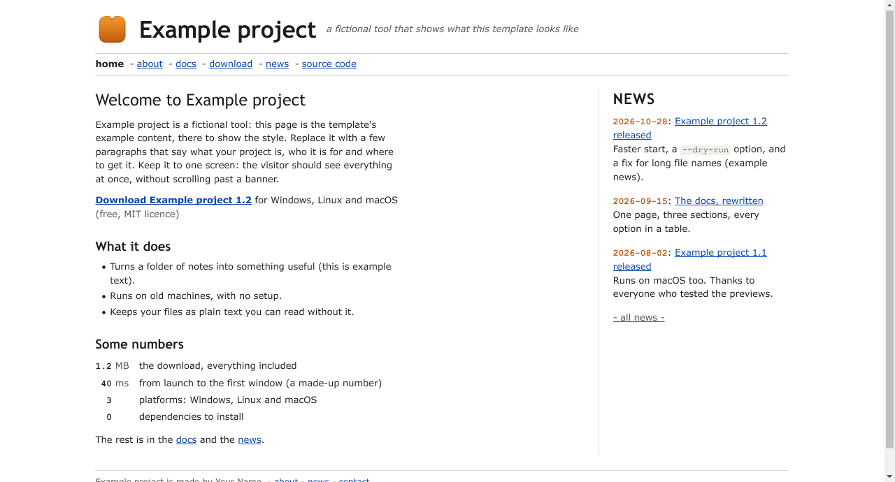

# Classic site template

A template for a project website in the classic style: one screen across and about one screen high, everything on
it at once. A header line with the logo, the name and a one-line tagline; a nav line of plain links; a welcome text
beside a NEWS column of dated entries; a footer line. Plain HTML and CSS, no JavaScript.

[Demo](https://sachahjkl.github.io/classic-site-template/) (the example content below, built by this repository's workflow)



## What the style is, and what it is not

It is:

- a page about one screen across (62rem), with all of the information on it at once;
- blue underlined links that turn purple once visited, Verdana for the text, Trebuchet for the headings, a monospace
  for code and dates, thin grey rules;
- a compact facts table: the number right-aligned, its unit, what it is;
- light and dark from the reader's `prefers-color-scheme`, every colour a token at the top of `theme/classic.css`;
- fine on a phone: under 760 px the NEWS column goes under the text, and nothing scrolls sideways;
- accessible: a skip link, landmarks (`header`, `nav`, `main`, `aside`, `footer`), alt text on every image (the
  build fails without it), a visible focus ring.

It is not trendy marketing design: no hero image, no carousel, no big call-to-action buttons, no scroll effects, no
cookie banner, no web fonts, no framework.

## Using the template

1. Press **Use this template** on GitHub to make your own repository from it.
2. Edit only these:
   - `site.json`: the name, the tagline, the logo, the nav links, the footer, the facts table, and an optional modern
     version (below);
   - `news/`: one file per entry (below);
   - `pages/*.html`: the content of each page, a fragment without `<html>`, `<head>` or the frame. `index.html` is the
     home; every other file becomes a page of the same name (`about.html`, `docs.html`, `download.html` are examples).
     A page's title is its first `<h1>`. `<!-- facts -->` in a page puts the facts table there.
   - `assets/`: images your pages use, copied into the site as they are.
3. Push to `master`. The workflow `.github/workflows/pages.yml` builds the site and deploys it to GitHub Pages
   (Settings > Pages > Source: GitHub Actions). Pages needs a public repository, or a paid plan for a private one.

Everything in this repository's `site.json`, `news/` and `pages/` is example content about a fictional "Example
project": replace it.

### News

One JSON file per entry in `news/`, named by its date: `news/2026-10-28-release-1-2.json`.

```json
{
  "title": "Example project 1.2 released",
  "link": "download.html",
  "text": "Faster start, a <code>--dry-run</code> option, and a fix for long file names."
}
```

`text` is HTML. `link` is optional: without it, the title links to the entry on the news page. The home shows the
newest three (`NEWS_ON_HOME` in `build.mjs`) and "- all news -" leads to `news.html`, which lists them all.

### The modern version

If the project also has a modern site, name it in `site.json`: `"modern": "https://example.com/"`. The footer then
ends with a "Modern version" link to it. Leave it `""` for none.

## The logo


`logo.mjs` draws the logo, from the same family as the Wren browser's and the toolkit's: a rounded square with a soft
vertical gradient, a darker border just inside its edge, a faint highlight, an optional semicircular notch in the top
edge, and a figure on it. The template's figure is empty (the frame alone, above). `site.json` sets it:

```json
"logo": { "variant": "amber", "notch": true, "figure": "empty" }
```

- `variant`: `amber`, `violet`, `cobalt` or `blueprint` (the colours are named at the top of `logo.mjs`);
- `notch`: the half circle cut into the top edge, or not;
- `figure`: `"empty"`, or the path of an SVG file of white shapes in the logo's 512-unit square.
  `assets/figure-example.svg` is one, and says what such a file may hold (rect, circle, ellipse, polygon, path with
  M L H V C Q Z; `data-min-detail` to keep a shape off the small sizes).

The build writes `logo.svg` (the header's logo), `logo.png` (512 px), `logo_256.png`, `logo_64.png`, `logo_32.png`,
`logo_16.png` and `favicon.ico` (16 to 256 px) into the site, and links the favicons from every page. Small sizes
are drawn simpler, as in the family: from 64 px the full drawing, at 32 and 48 px a little larger figure, at 16 and
24 px no notch, no highlight and a thinner margin. To get the files alone: `node logo.mjs [out-dir]`;
`node logo.mjs --sheet [out-dir]` adds `sizes.html`, every size on a light and on a dark background.

## Building locally

```sh
node build.mjs
```

Plain Node 20 or later, no packages to install. It writes `dist/`: every page in the classic frame, the home's NEWS
column, `news.html`, the logo and favicons, `classic.css` and `assets/`. Then it checks that every internal link
and `#anchor` of `dist/` leads somewhere and that every `` has an alt; it exits non-zero, saying what is wrong,
otherwise (the workflow then does not deploy). Open `dist/index.html` in a browser to look at it.

## The files

| File | What it is |
| --- | --- |
| `site.json` | the name, tagline, logo, nav, footer, facts, modern version |
| `news/` | the news, one JSON file per dated entry |
| `pages/` | the content of each page |
| `assets/` | images the pages use; `figure-example.svg`, an example logo figure |
| `theme/classic.css` | the style, its colours and fonts as tokens at the top |
| `build.mjs` | the build and the link check |
| `logo.mjs` | the logo and favicons |
| `.github/workflows/pages.yml` | builds and deploys to GitHub Pages on every push to `master` |
| `docs/` | the pictures of this README |

## Licence

MIT, see [LICENSE](LICENSE).
